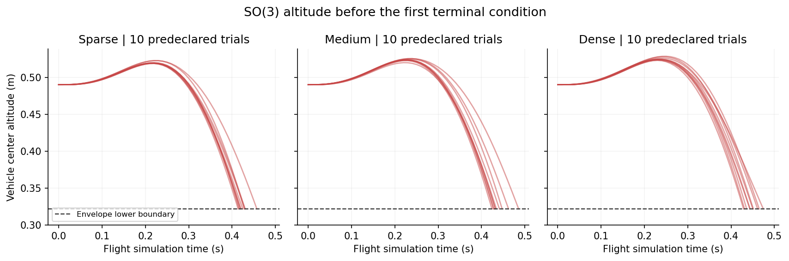
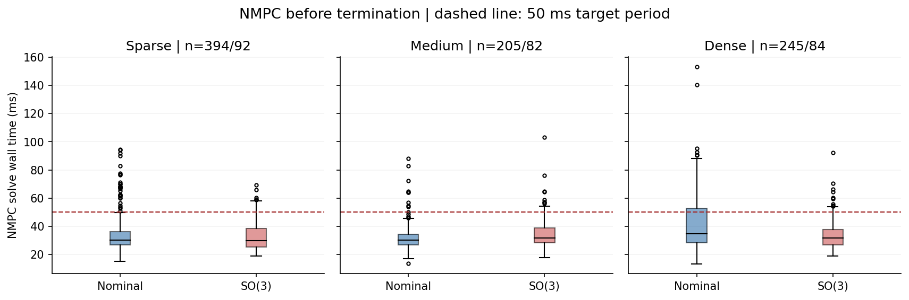

# CORTO Table III 复现实验结果

迁移、编译、数值回归和 60 个正式回合已完成。
本次固定配置未复现论文 Table III 的性能。
两个执行条件均为 0/30 成功。

## 实验版本与完成范围

仓库：`/home/tong/tongworkspace/projects/aerial/SUPER-CORTO`。
正式实验提交：`ef8e8e472dbbac40f4b91581582d848a83697234`。
实验日期：2026-11-15，UTC。

| 来源 | 固定提交 |
| --- | --- |
| SUPER | `2ad3419c127a617c6d7df6925e81a14175a9c096` |
| CORTO-Planner | `e05a2e60f78d9ae4425981c1343913c3c67d3bb3` |
| EGO-Planner | `bfda51284c8c1b476043255a8145ef925a3778a5` |

6 个算法阶段均已移植：Topo-PRM、弧长三次样条、MOSEK SOCP、PTF 连续椭圆安全飞行走廊、NLopt SLSQP 非线性模型预测控制（NMPC），以及异步重规划和计划交接。
原版 RK4、目标函数、约束和解析 Jacobian 保留。
未引入其他规划算法。

ROG-Map 加载固定 PCD，提供占据和膨胀查询。
PerfectDrone 保留 `perfect`，并增加 `so3`。
SO(3) 模式通过角速度内环和旋翼分配执行 CTBR 指令。
CTBR 表示总推力与机体系角速度。
NMPC 读取实际 Odometry，未用预测状态覆盖物理状态。
MARSIM、TF、LiDAR 和 RViz 已验证可运行。

## 算法一致性与工程验证

| 检查 | 结果 | 证据 |
| --- | --- | --- |
| ROS 2 Jazzy 独立构建 | 5 个包编译通过 | [build.log](../results/validation/build.log) |
| 原版与移植固定输入回归 | 23 组、1479 个数值；最大绝对误差 0 | [regression.json](../results/numerical_regression/regression.json) |
| 真实 ROG-Map 契约 | 坐标、边界、未知及膨胀检查通过 | [corto_ctest.log](../results/validation/corto_ctest.log) |
| SO(3) 动力学 | 悬停、电机滞后、角速度跟踪及旋转矩阵检查通过 | [dynamics_ctest.log](../results/validation/dynamics_ctest.log) |
| 两模式 ROS 接口 | Odometry、TF、marker、path 和非空 LiDAR 通过 | [simulator_smoke_final](../results/simulator_smoke_final/) |
| 正式 nominal 执行关系 | 835 个完整转移；最大 RK4 残差 1.776357e-15 | [nominal_diagnostics.md](../results/table3/nominal_diagnostics.md) |
| 60 回合完整性与统计复算 | 无缺少回合，无终止前进程异常 | [final_audit.md](../results/table3/final_audit.md) |
| 最终版本停止流程 | 两模式的规划与仿真进程均正常退出 | [validation.json](../results/integration_final/validation.json) |

数值一致性说明移植保留了原版计算。
它不证明原版输出在新地图和物理模型中必然安全。

## 场景与统计定义

三个场景均为 30×15×3 m，障碍数为 45、90、180。
作者公开 Medium JSON 有 100 个障碍。
本次因此按论文密度重建场景，并记录生成种子 20261115。
规划种子固定为 0–9，没有根据成功与否重新抽样。
每个执行条件各运行三场景、每场景 10 回合。

速度设置为 10 m/s，SOCP 加速度设置为 5 m/s²。
NMPC 预测 10 步，每步 0.05 s，目标频率为 20 Hz。
SOCP 使用 100 个节点。
原版 NMPC 没有独立的加速度硬约束，本次未另加约束。

成功要求到达目标 0.2 m 范围，且此前未碰撞或越界。
主碰撞模型为半径 0.322 m 的保守球包络。
该半径来自 EGO 臂长 0.26 m 与桨半径 0.062 m。
它是评测包络，不是 EGO 原生碰撞网格。
净空从未膨胀的原始实体障碍计算。
地图边界单独检查，不并入障碍净空。

回合在首次碰撞、越界、到达或超时结束。
触发帧和后续 0.3 s 原始消息均保留。
规划统计同时按终止时间和接收顺序截断。
失败调用计入均值；在线重规划排除初始规划。
完整规则见 [PROTOCOL.md](../experiments/PROTOCOL.md)。

## Table III 对照

论文数值取自 [Table III](https://doi.org/10.1109/LRA.2026.3700428)。
文中 Online T 表示在线重规划耗时。
论文未完整公开碰撞几何及净空聚合细节。

| 条件 | 场景 | 成功率 | 飞行时间 s | 平均速度 m/s | 净空 m | 在线重规划 ms | 重规划调用数 |
| --- | --- | ---: | ---: | ---: | ---: | ---: | ---: |
| 论文 | Sparse | 100% | 5.15 | 4.47 | 0.11 | 43.1 | 未公开 |
| 论文 | Medium | 100% | 5.23 | 4.42 | 0.07 | 57.9 | 未公开 |
| 论文 | Dense | 100% | 4.24 | 4.73 | 0.15 | 59.1 | 未公开 |
| nominal | Sparse | 0/10 | — | — | — | 122.40 | 33 |
| nominal | Medium | 0/10 | — | — | — | 145.19 | 2 |
| nominal | Dense | 0/10 | — | — | — | 125.52 | 14 |
| SO(3) | Sparse | 0/10 | — | — | — | — | 0 |
| SO(3) | Medium | 0/10 | — | — | — | — | 0 |
| SO(3) | Dense | 0/10 | — | — | — | — | 0 |

飞行时间、速度和净空只对成功回合求均值。
本次没有成功回合，因此这些均值未定义。
SO(3) 在首次在线重规划完成前已终止。
其在线重规划栏为空，不代表规划耗时为 0。
各回合失败轨迹的时间、速度和净空仍保存在逐回合表中。

| 条件 | 场景 | 首次碰撞 | 首次越界 | 平均观测飞行时长 s | 规划失败 / 调用 | NMPC 负返回 / 调用 |
| --- | --- | ---: | ---: | ---: | ---: | ---: |
| nominal | Sparse | 8 | 2 | 1.995 | 0/43 | 1/394 |
| nominal | Medium | 10 | 0 | 1.075 | 1/13 | 0/205 |
| nominal | Dense | 6 | 4 | 1.255 | 12/31 | 3/245 |
| SO(3) | Sparse | 0 | 10 | 0.430 | 0/10 | 0/92 |
| SO(3) | Medium | 0 | 10 | 0.447 | 1/11 | 0/82 |
| SO(3) | Dense | 0 | 10 | 0.455 | 7/17 | 0/84 |

观测飞行时长截至触发帧，不能替代成功任务的飞行时间。
总计 125 次规划调用，21 次失败。
其中 49 次在线重规划，5 次失败。
总计 1102 次 NMPC 求解，4 次返回负状态。

## 差距分析

### 新场景和机体包络改变了评测条件

三张场景是可复现重建，不能称为作者原始 Table III 地图。
圆环按 0.2 m 管体直径重建，而原版 GridMap 忽略该厚度字段。
ROG-Map 的膨胀邻域与原版栅格也有明确差异。
这些语义已写入 [UPSTREAM.md](UPSTREAM.md) 和实验协议。

0.322 m 包络大于原版规划的 0.1 m 膨胀量。
因此，原版规划器通过的路线未必适合该包络。
报告同时保留中心点和 0.1 m 球体净空。
它们仅描述已记录轨迹，不能推断较小机体继续飞行后的成功率。

### SO(3) 出现早期大倾角和下降

30 个 SO(3) 回合均因下边界 `z_lower` 终止。
插值接触时，机体中心高度为 0.322 m。
Sparse、Medium、Dense 的平均首次触发时刻分别为 0.425666、0.441231、0.448350 s。
各回合的峰值倾角为 75.224–103.345°。
28/30 回合的末次归一化推力接近原版上限 0.8。
此前 258 次 NMPC 求解均返回 code=3。

原版预测模型直接执行机体角速度和推力。
真实执行增加了角速度内环、旋翼分配和电机滞后。
上述观测说明大倾角、模型差异与早期下降相关。
现有数据不足以确定唯一失效原因。
nominal 的 30 回合中，27 回合首次失效前也没有 NMPC 负返回。
因此，不能把全部失败归因于求解器报错。

### 20 Hz 是配置目标，实际时序存在偏差

本机使用双路 Xeon Silver 4210R 和 RTX 4090。
收包墙钟测得 nominal 控制频率为 18.555 Hz，SO(3) 为 18.221 Hz。
该频率包含传输与记录器调度，不能视为执行器消费频率。
SO(3) 的观测窗口较短，也不能据此推断稳态频率。

nominal 的 NMPC 均值为 35.597 ms，P95 为 67.984 ms。
其中 106/844 次超过 50 ms，占 12.56%。
SO(3) 的均值为 35.048 ms，P95 为 59.165 ms。
其中 40/258 次超过 50 ms，占 15.50%。

物理状态在控制停顿期间仍持续发布。
例如一次 148.485 ms 控制间隔内，仍收到 15 条连续状态。
Dense 飞行窗的仿真时间与接收墙钟比为 0.909353–0.961213。
其中两个回合合计出现 3 个未观测的 10 ms 状态槽位。
数据不能单独区分物理线程调度、发布延迟和接收排队。
本报告没有将 Dense 描述为严格实时。

### 保留原版行为，不为匹配表值修改算法

移植保留了原版的 SFC 25% 投影点违反验收阈值。
移植也保留了控制序列移位后执行第 2 个优化输入的行为。
SOCP 重规划入口的速度参数语义同样保持原样。
这些行为记录于 [PORT_NOTES.md](../corto_ros2/PORT_NOTES.md)。
本次没有通过修改这些逻辑、筛选种子或更换统计口径匹配论文。
本配置的失败不能直接否定论文在其原始条件下的结果。

## 数据、关闭异常与交付版本

正式数据共包含 18372 条状态、1427 条 CTBR 和 1798 条事件。
所有 60 个 run 的提交号一致，源码修改标记均为 false。
清单和场景校验值均与冻结提交一致。

20 个回合在采集和评分完成后出现关闭异常。
异常来自无效 ROS context 上的 `WallRate::sleep()`。
SIGINT 前的进程异常数为 0。
原始日志和实际子进程退出码保留在最终审计中。

正式实验结束后，交付代码补充了该关闭异常的处理。
修复只在 context 已停止且异常文本匹配时生效。
其他运行异常继续抛出。
重新编译后，两模式的规划器与仿真器均正常退出。
这两次验证未替换任何正式回合。

主要入口：

- [Table III 汇总](../results/table3/table3.md)
- [60 回合逐回合指标](../results/table3/trials.csv)
- [固定清单与种子](../experiments/manifest.json)
- [完整原始数据目录](../results/table3/)
- [nominal 执行一致性](../results/table3/nominal_diagnostics.md)
- [实际频率、姿态与时钟诊断](../results/table3/runtime_diagnostics.md)
- [全量审计](../results/table3/final_audit.md)
- [可复现编译与运行命令](RUNNING.md)
